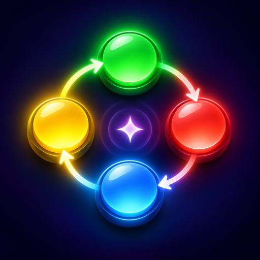
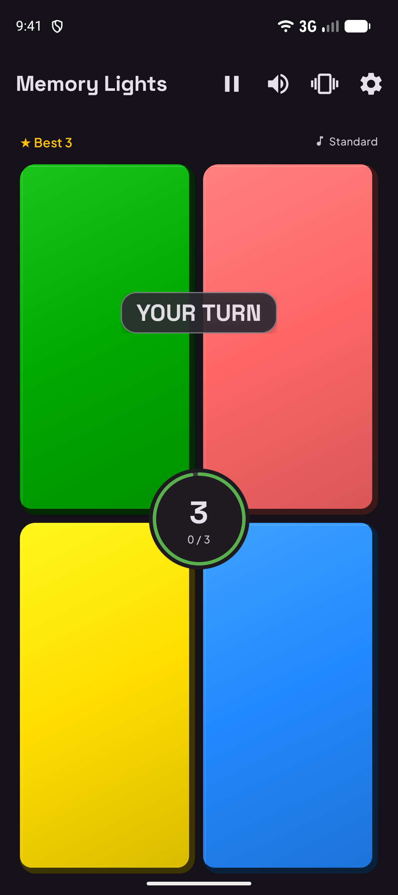
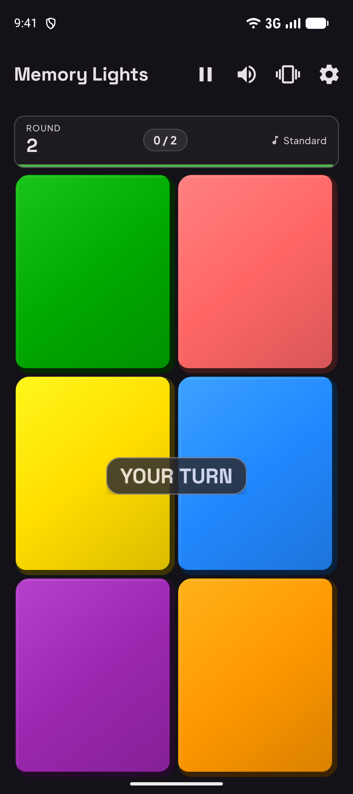
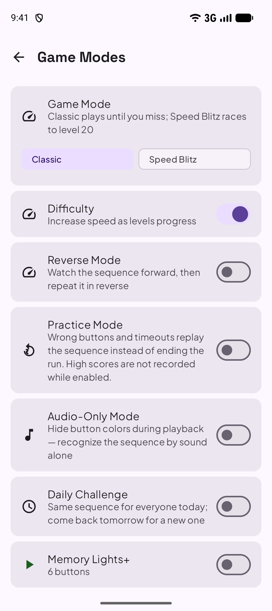
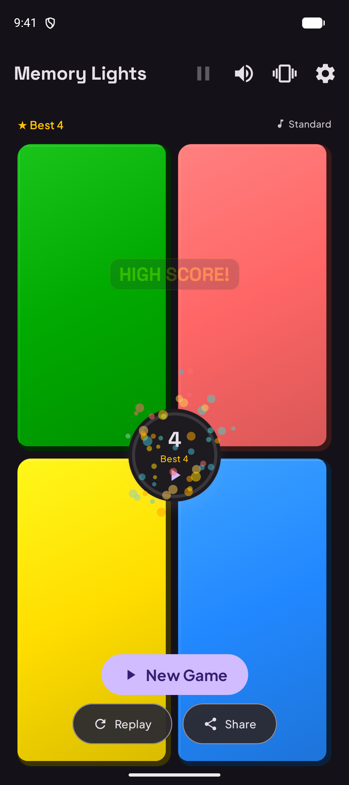

<p align="center">
  
</p>

<h1 align="center">Memory Lights</h1>

<p align="center">
  A memory game for Android. Watch the lights flash a pattern, then repeat it.<br>
  Built with Kotlin, Jetpack Compose and Material 3.
</p>

<p align="center">
  <a href="LICENSE"></a>
  
  
  
</p>

<p align="center">
  
  
  
  
</p>

## About

Memory Lights is a modern take on the classic handheld memory game. The game plays a sequence of colored lights and sounds, and you repeat it. Every round adds one more step. It works fully offline, has no accounts, no ads and no tracking, and keeps all scores on the device.

## Features

**Game modes**
- **Classic**: the sequence grows until you miss.
- **Speed Blitz**: race to a fixed target level; your best time is saved.
- **4 or 6 buttons**: the standard four colors, or the six-color Memory Lights+ board.
- **Modifiers**: Reverse (repeat the sequence backward), Practice (a wrong tap replays the sequence), Audio-Only, and a difficulty setting that speeds the game up as you climb.

**Sound and feel**
- Seven sound packs: Standard, Funny, Electronic, Retro, Musical, Nature and Sci-Fi.
- Vibration toggle and a master mute button.

**Polish and accessibility**
- Adjustable turn timeout with a visible countdown ring.
- Pause, replay the last sequence, and share a 1080x1080 score card.
- High score, full statistics and achievements.
- Optional shapes on the buttons for color-blind players.
- AMOLED black and dark themes, edge-to-edge layout, 48dp touch targets and content descriptions.
- Screen-reader announcements for level, your turn and game over.

## Getting started

**Requirements:** Android Studio (recent stable), JDK 17 or newer, and an Android 12+ (API 31) device or emulator. The Gradle wrapper downloads the right Gradle version.

```bash
git clone https://github.com/guyguy2/MemoryLights.git
cd MemoryLights
./gradlew installDebug
```

Or open the folder in Android Studio and press Run.

### Common commands

| Task | Command |
|---|---|
| Build everything | `./gradlew build` |
| Install the debug app | `./gradlew installDebug` |
| Unit tests | `./gradlew test` |
| One test class | `./gradlew test --tests "com.happypuppy.memorylights.SimonGameViewModelTest"` |
| Instrumented tests (device needed) | `./gradlew connectedAndroidTest` |
| Lint | `./gradlew lint` |

## Tech stack

| Area | Choice |
|---|---|
| Language | Kotlin 2.4 (built into AGP 9, no separate Kotlin plugin) |
| UI | Jetpack Compose, Material 3 |
| Architecture | MVVM, `StateFlow`, one `ViewModel` for the game |
| Dependency injection | Koin |
| Persistence | Jetpack DataStore |
| Audio | `SoundPool`, plus the vibrator service |
| SDK | min 31, target 36, compile 37.1 |
| Tests | JUnit 4, MockK, Turbine, kotlinx-coroutines-test |

## Project structure

```
app/src/main/java/com/happypuppy/memorylights/
├── data/          # sound manager, settings and statistics repositories
├── di/            # Koin module
├── domain/        # game state, enums (buttons, modes, sound packs), models
└── ui/            # screens, components, navigation, theme, game ViewModel
tools/sounds/      # scripts that synthesize the Musical, Nature and Sci-Fi packs
playstore/         # store listing copy, graphics and release checklist
docs/              # GitHub Pages site (privacy policy)
specs/             # roadmap and per-session engineering notes
```

The game logic lives in `SimonGameViewModel`. It moves through five states (`WaitingToStart`, `ShowingSequence`, `PlayerRepeating`, `GameOver`, `Settings`) and exposes one immutable UI state that the Compose screens render. State changes use `.update { it.copy(...) }`, and all coroutines run on `viewModelScope`, so the game pauses and resumes with the app lifecycle.

## Sound packs

The Standard and Funny packs are original recordings. The Musical, Nature and Sci-Fi packs are synthesized by deterministic Python scripts in [`tools/sounds`](tools/sounds), so re-running a script reproduces the same files. There are no third-party samples; see [`SOUND_LICENSES.md`](tools/sounds/SOUND_LICENSES.md).

## Privacy

The app makes no network calls and collects no data. Its only permission is `VIBRATE`. Read the [privacy policy](https://guyguy2.github.io/MemoryLights/privacy.html).

## Contributing

Issues and pull requests are welcome. Before opening a pull request, please run `./gradlew test lint` and add tests alongside any behavior change. The project conventions are in [`CLAUDE.md`](CLAUDE.md).

## License

Released under the [MIT License](LICENSE).

## Acknowledgments

Inspired by the classic Simon electronic game created by Ralph Baer and Howard Morrison. Memory Lights is an independent project and is not affiliated with or endorsed by the makers of Simon. Simon is a trademark of its respective owner.
